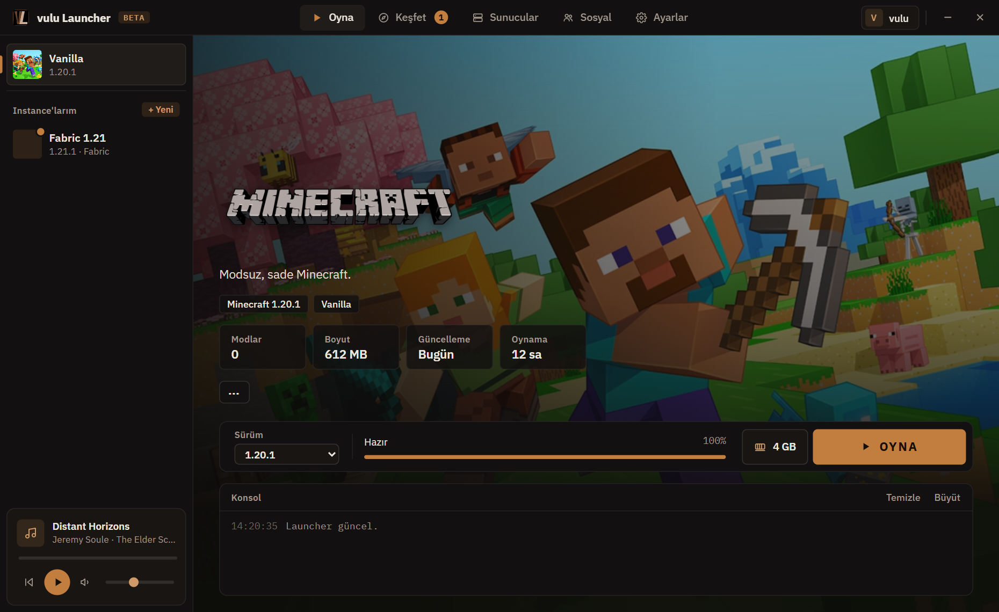

# vulu Launcher

Minecraft'ı kurmayı, modlamayı ve oynamayı tek bir uygulamada toplayan bir launcher.

**[İndir (vulu-launcher-setup.exe)](https://vuluvulu.com.tr/releases/vulu-launcher-setup.exe)** · [vuluvulu.com.tr](https://vuluvulu.com.tr/launcher)

 

## Kurulum

`vulu-launcher-setup.exe` dosyasını indirip çalıştır. Launcher her açılışta kendini günceller. Kaldırmak için Windows'un "Uygulamalar" listesini kullanabilirsin.

Hesaplar davetle açılır: giriş ekranından ya da [siteden](https://vuluvulu.com.tr/kayit) katılma isteği gönderilir, bir admin onaylar.

Windows ilk seferde SmartScreen uyarısı verebilir: *Ek bilgi → Yine de çalıştır*.

## Neler var

- Vanilla ve kendi instance'ların (Fabric, Quilt, Forge, NeoForge); Java kendiliğinden indirilir
- Modrinth'ten mod, kaynak paketi, shader ve modpack kurma
- vulu Packs: paylaşılan paketlerin tek tıkla kurulumu ve güncellemesi
- Sunucular sekmesi: vulu sunucularının durumu ve tek tıkla bağlanma
- Sosyal: ekran görüntüsü paylaşma, uçtan uca şifreli mesajlar, arkadaş listesi
- Çökme yardımcısı ve eksik mod denetimi
- Dünya yedekleri, oynama süresi, skinler, Discord durumu
- Üç tema: Classic, Neon, Atlas

## Lisans

[AGPL-3.0](LICENSE). Launcher'ı özgürce kullanabilir, değiştirebilir ve dağıtabilirsiniz. Değiştirilmiş bir sürümü dağıtan ya da sunucuda çalıştırıp başkalarına sunan, kaynak kodunu da aynı lisansla açmalı ve bu projenin telif ve lisans bildirimlerini korumalıdır.

"vulu" adı ve VL logosu lisansa dahil değildir: kendi sürümünüzü dağıtırken farklı bir ad ve logo kullanın.

Kullanılan üçüncü taraf bileşenler ve lisansları: [THIRD-PARTY-NOTICES.md](THIRD-PARTY-NOTICES.md).
