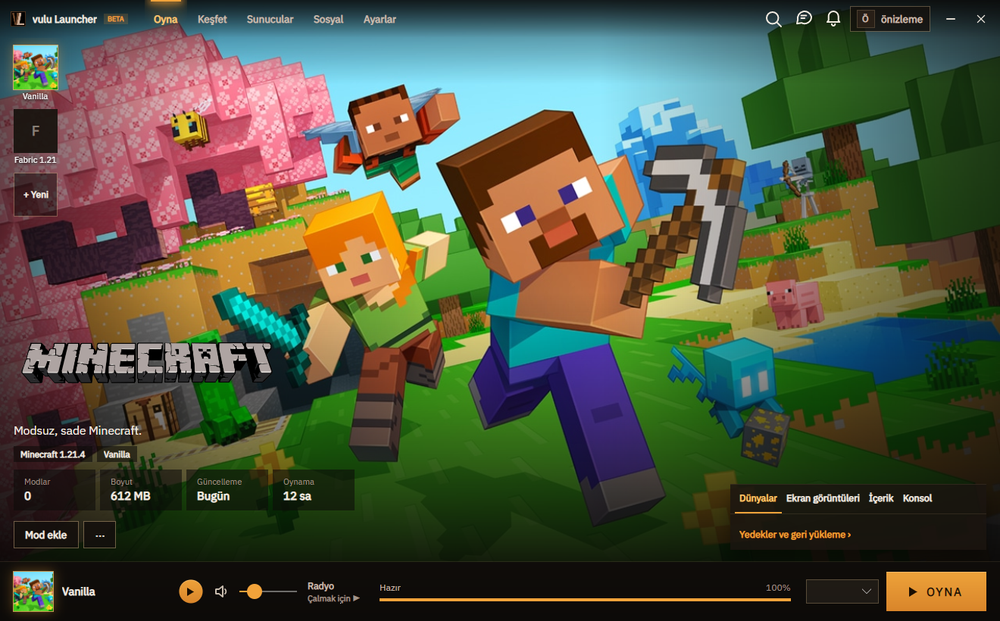

<div align="center">


# vulu Launcher

Minecraft'ı kurmayı, modlamayı ve oynamayı tek bir uygulamada toplayan bir launcher.

<a href="https://github.com/vuluvulu1/vulu-launcher/releases/latest"></a>
<a href="https://vuluvulu.com.tr/launcher"></a>
<a href="LICENSE"></a>


**[İndir (vulu-launcher-setup.exe)](https://vuluvulu.com.tr/api/download/windows)** · [vuluvulu.com.tr](https://vuluvulu.com.tr/launcher)

<br>



</div>

## Kurulum

`vulu-launcher-setup.exe` dosyasını indirip çalıştır. Launcher her açılışta kendini günceller; güncellemeler imzalıdır, imzası tutmayan sürüm kurulmaz. Kaldırmak için Windows'un "Uygulamalar" listesini kullanabilirsin.

Hesaplar şimdilik admin onayıyla açılıyor: giriş ekranından ya da [siteden](https://vuluvulu.com.tr/kayit) kayıt ol, e-postana gelen bağlantıyı aç; bir admin onaylayınca hesabın açılır.

Windows ilk seferde SmartScreen uyarısı verebilir: *Ek bilgi → Yine de çalıştır*.

## Neler var

**Oyun**
- Vanilla ve kendi instance'ların (Fabric, Quilt, Forge, NeoForge); doğru Java sürümü kendiliğinden iner
- Hızlı açılış: oyun açılırken hangi aşamada olduğu ve genelde ne kadar sürdüğü görünür
- Çökme yardımcısı: suçlu modu söyler, tek tıkla kapatır; eksik bağımlılık ve bozuk dosya denetimi
- Dünya yedekleri, oynama süresi, oyunun konsolu, masaüstü kısayolları (bir paketi ya da sunucuyu tek tıkla açar)

**İçerik**
- CurseForge ve Modrinth'ten mod, kaynak paketi, shader ve modpack kurma, bağımlılıklarıyla birlikte
- Yapımcısının başka uygulamalara kapattığı CurseForge dosyaları: tarayıcıdan indirirsin, launcher yerine koyar
- vulu Packs: ekibin paylaştığı paketleri tek tıkla kurma ve güncelleme; her güncellemede neyin değiştiği görünür, açık kaynak paketleri ve sıraları da paketle gelir

**Topluluk**
- Sunucular: canlı durum, sunucu simgesi ve renkli MOTD, tek tıkla bağlanma
- Sosyal: arkadaşlar, ekran görüntüsü akışı ve yorumlar, uçtan uca şifreli mesajlar
- Skinler, profil ve banner, Discord durumu, bildirim merkezi ve Windows bildirimleri

**Arayüz**
- Meşale teması ve yanan açılış animasyonu; seçili paketin dünyası bütün sayfaların arkasında
- Paketleri sürükleyerek sıralama, sağ tık menüleri, hızlı arama (Ctrl+K)
- İndirme paneli (hız, kalan süre, duraklat), internet radyosu, arayüz boyutu ayarı

## Geliştirme

| Klasör | İçerik |
| --- | --- |
| `Core/` | Launcher'ın bütün işi: oyun kurma ve açma, paketler, hesap, sunucu istekleri. Arayüz bunu komutlarla çağırır. |
| `Social/` | Launcher'la mobil uygulamanın ortak kodu: sunucu istemcisi, giriş, uçtan uca şifreli mesajlar |
| `Launcher/` | Windows arayüzü (Avalonia, MVVM) |
| `Updater/`, `Installer/` | Güncelleyici ve kurulum programı |
| `Shared/` | Ortak kod; yazı tipleri, görseller ve lisans dosyaları |
| `Tests/` | Birim testleri |
| `Android/` | Android uygulaması (.NET MAUI, `Android/wwwroot` web arayüzü) |
| `Mobile/` | vulu Sosyal: telefondaki sosyal uygulama (Avalonia), [plan](docs/mobile-plan.md) |
| `tools/` | Yayın ve test betikleri |

Derlemek için .NET 10 SDK yeterli:

```
dotnet build Launcher
dotnet test Tests
```

Yayın `tools/publish-release.ps1` ile yapılır: Launcher, Updater ve kurulum programı derlenir, sürüm bilgisi imzalanır ve sunucuya yüklenir. `tools/local-test.ps1` kurulumu ve güncellemeyi sunucuya yüklemeden bu bilgisayarda denemeyi sağlar.

### Android

Android uygulaması ([APK](https://vuluvulu.com.tr/api/download/android), Android 8 ve üstü) şu an geliştirilmiyor; son sürümü çalışıyor ama Windows'taki yenilikler ona gelmiyor. Aynı `Core/` komutlarını web arayüzüyle kullanır; Minecraft'ı [Amethyst](https://github.com/AngelAuraMC/Amethyst-Android) motoruyla telefonda açar.

## Teşekkürler

- **[CmlLib.Core](https://github.com/CmlLib/CmlLib.Core)**: oyunu ve mod yükleyicilerini kuran ve başlatan kütüphane (MIT).
- **[Avalonia](https://avaloniaui.net)**: Windows arayüzünün çizildiği kütüphane (MIT).
- **[authlib-injector](https://github.com/yushijinhun/authlib-injector)**: skinlerin vulu üzerinden çalışmasını sağlayan Java ajanı (AGPL 3.0). Launcher pakete gömmez; ilk ihtiyaçta resmî adresinden indirir.
- **[CurseForge](https://www.curseforge.com/minecraft)** ve **[Modrinth](https://modrinth.com)**: mod, kaynak paketi, shader ve modpack'lerin kaynağı. İçerikler yapımcılarına aittir; launcher onları bu platformların kendi sunucularından indirir.
- **[Amethyst](https://github.com/AngelAuraMC/Amethyst-Android)** (AngelAuraMC) ve onun temeli **[PojavLauncher](https://github.com/PojavLauncherTeam/PojavLauncher)**: Android'de Minecraft'ı açan oyun motoru (GNU LGPL 3.0); vulu için yapılan değişiklikler [vulu-amethyst](https://github.com/vuluvulu1/vulu-amethyst) deposunda.

Bütün bileşenlerin listesi ve lisansları: [THIRD-PARTY-NOTICES.md](THIRD-PARTY-NOTICES.md).

## Lisans

[AGPL-3.0](LICENSE). Launcher'ı özgürce kullanabilir, değiştirebilir ve dağıtabilirsiniz. Değiştirilmiş bir sürümü dağıtan ya da sunucuda çalıştırıp başkalarına sunan, kaynak kodunu da aynı lisansla açmalı ve bu projenin telif ve lisans bildirimlerini korumalıdır.

"vulu" adı ve VL logosu lisansa dahil değildir: kendi sürümünüzü dağıtırken farklı bir ad ve logo kullanın.

Minecraft, Mojang Studios'un ticari markasıdır; vulu Launcher resmî bir Minecraft ürünü değildir ve Mojang ya da Microsoft ile bağlantılı değildir.
