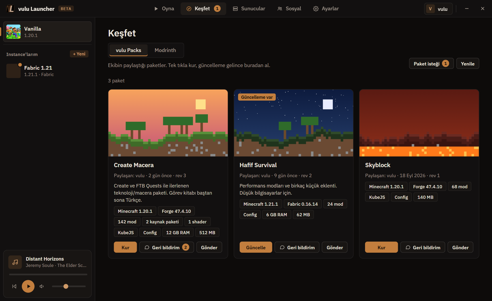
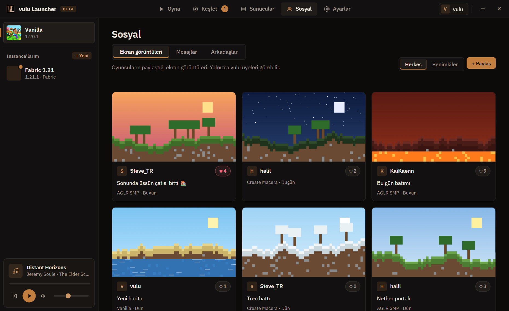
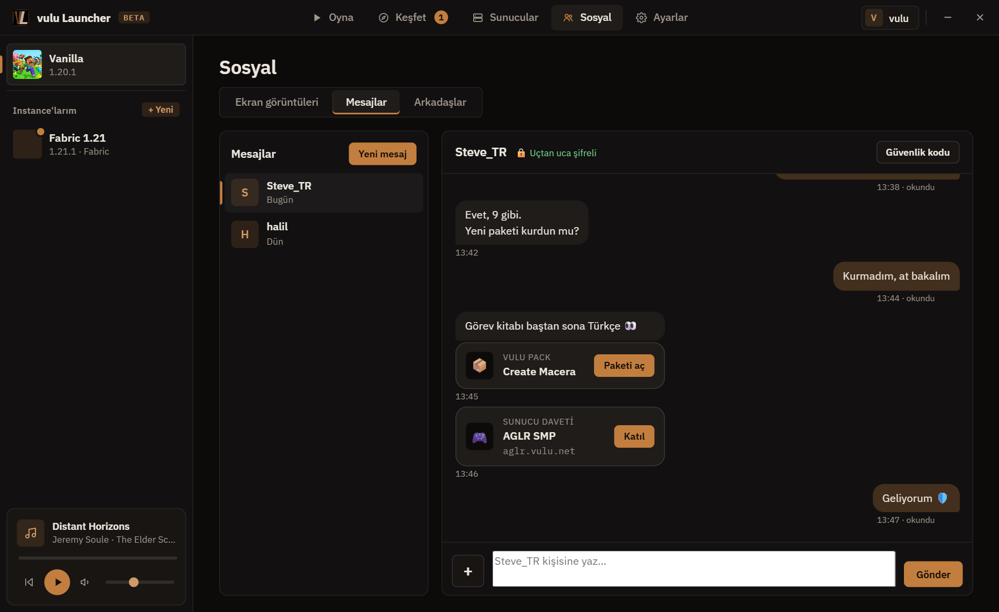
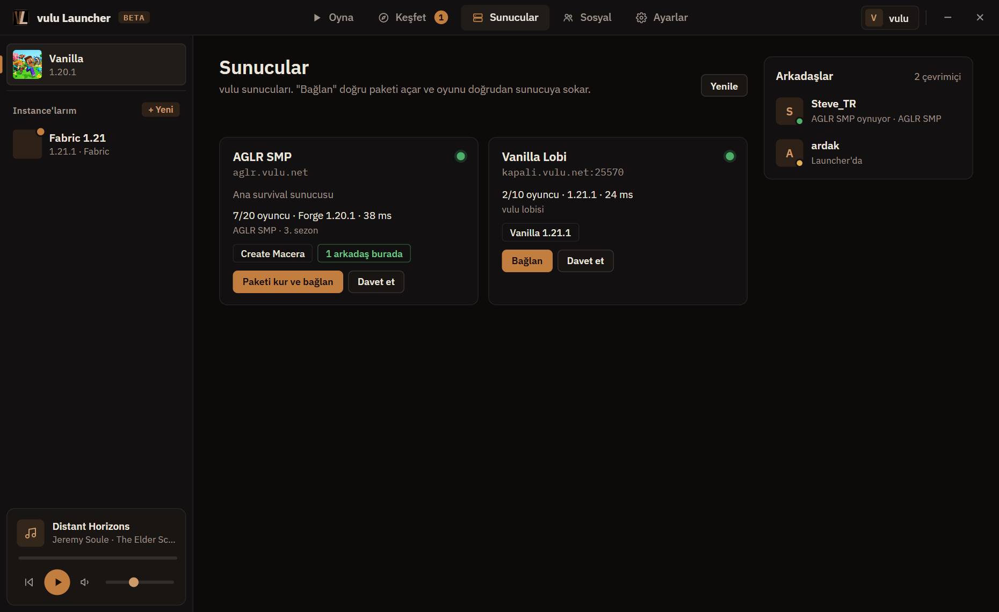

# vulu Launcher

**Arkadaş grubumuz için yapılmış, her şeyi tek yerde toplayan bir Minecraft launcher'ı.** 
Paketler, sunucular, şifreli mesajlar ve ekran görüntüleri; hepsi tek tıkla.

[**⬇️ İndir**](https://github.com/vuluvulu1/vulu-launcher/releases/latest/download/vulu-launcher-setup.exe) &nbsp;·&nbsp;
[Özellikler](#-özellikler) &nbsp;·&nbsp;
[Kurulum](#-kurulum) &nbsp;·&nbsp;
[Gizlilik](#-gizlilik-ve-güvenlik) &nbsp;·&nbsp;
[SSS](#-sık-sorulanlar)

 

 

> [!NOTE]
> vulu Launcher **davetle** kullanılır. Giriş ekranından hesap isteği gönderirsin, bir admin onaylayınca giriş yapabilirsin.

## ✨ Özellikler

<table>
<tr>
<td width="50%" valign="top">

### 📦 vulu Packs
Grubun paylaştığı mod paketleri tek tıkla kurulur. Modlar, config dosyaları, kaynak paketleri, shaderlar ve KubeJS (ör. FTB Quests görev kitabı) birlikte gelir. Paket güncellenince launcher haber verir; dünyaların güncellemeden önce otomatik yedeklenir.

</td>
<td width="50%" valign="top">

</td>
</tr>
<tr>
<td width="50%" valign="top">

</td>
<td width="50%" valign="top">

### 📸 Sosyal
Oyunda F2 ile aldığın ekran görüntülerini herkesle paylaşırsın. Akışta beğenirsin, büyük görürsün, istersen bilgisayarına kaydedersin. Arkadaşlar sekmesinde kimin çevrimiçi olduğu ve ne oynadığı görünür.

</td>
</tr>
<tr>
<td width="50%" valign="top">

### 💬 Uçtan uca şifreli mesajlar
Arkadaşlarınla doğrudan yazışırsın; mesajları yalnızca ikiniz okuyabilirsiniz. Sohbetten bir paketi ya da sunucuyu kart olarak gönderirsin, karşı taraf tek tıkla kurar ya da katılır. Launcher arkadayken yeni mesaj Windows bildirimi olarak gelir.

</td>
<td width="50%" valign="top">

</td>
</tr>
<tr>
<td width="50%" valign="top">

</td>
<td width="50%" valign="top">

### 🎮 Sunucular
vulu sunucuları canlı durumlarıyla listelenir: kaç oyuncu var, hangi sürüm, gecikme ne kadar, hangi arkadaşın orada. "Bağlan" doğru paketi açar (gerekirse önce kurar) ve seni doğrudan sunucuya sokar.

</td>
</tr>
</table>

### …ve daha fazlası

| | |
|---|---|
| 🧱 **Kendi instance'ların** | Vanilla, Fabric, Quilt, Forge ve NeoForge. Doğru Java sürümü kendiliğinden indirilir. |
| 🔎 **Modrinth** | Mod, kaynak paketi, shader ve modpack arayıp kur. Bağımlılıklar kendiliğinden gelir. |
| 🩺 **Çökme yardımcısı** | Oyun çökünce nedenini sade bir dille anlatır (eksik mod, uyumsuz sürüm, RAM, sürücü…). Çoğu sorunu tek tıkla çözer. |
| 🧩 **Eksik bağımlılık denetimi** | Oyun açılmadan önce modlar taranır; eksik olan adıyla gösterilir ve tek tıkla kurulur. |
| 🔁 **Mod güncellemeleri** | Modları silmeden aç/kapat, tek tek ya da hepsini birden güncelle. |
| 🌍 **Dünya yedekleri** | Dünyalarını yedekle ve geri yükle. Paket güncellemelerinden önce otomatik yedek alınır. |
| ⏱️ **Oynama süresi** | Her paket için toplam süre, son oynama zamanı ve kaç kez açıldığı. |
| 🖼️ **Ekran görüntüsü galerisi** | Görüntülere göz at, Discord'a yapıştırmak için kopyala, sil (geri dönüşüm kutusuna). |
| 👕 **Skinler** | Kendi skinini yükle; vulu sunucularında herkes görür. |
| 🎨 **Üç tema** | Classic, Neon ve Atlas; vurgu rengini de sen seç. |
| 🟣 **Discord durumu** | "AGLR SMP oynuyor" gibi; vulu pack'in logosuyla birlikte. |
| 📤 **Paylaşma ve dışa aktarma** | Instance'ı çoğalt ya da `.mrpack` olarak dışa aktar. |

## 🚀 Kurulum

1. **[vulu-launcher-setup.exe](https://github.com/vuluvulu1/vulu-launcher/releases/latest/download/vulu-launcher-setup.exe)** dosyasını indir ve çalıştır.
2. Kurulum en yeni sürümü indirir, masaüstüne ve Başlat menüsüne kısayol koyar.
3. Launcher'ı aç, **hesap iste** ve admin onayını bekle.

Launcher her açılışta kendini günceller; yeni bir şey yapman gerekmez. Kaldırmak için Windows'un **Uygulamalar** listesini kullanabilirsin.

<b>Windows "Bilgisayarınız korundu" uyarısı veriyor</b>

 

Launcher imzalı bir yayıncı sertifikası kullanmadığı için SmartScreen ilk seferde uyarabilir. **Ek bilgi → Yine de çalıştır** ile devam edebilirsin. Güncellemeler ise launcher'ın içine gömülü bir anahtarla imzalanır ve doğrulanmadan kurulmaz.

<b>"WebView2 gerekli" diyor</b>

 

Windows 10/11'in çoğunda zaten kuruludur. Değilse Microsoft'un [WebView2 Runtime](https://go.microsoft.com/fwlink/p/?LinkId=2124703) sayfasından ücretsiz kurabilirsin.

## 🔒 Gizlilik ve güvenlik

- **Mesajlar uçtan uca şifrelidir.** Şifreleme launcher'da yapılır (ECDH P-256 + HKDF + AES-256-GCM); vulu sunucusu yalnızca şifreli metni iletir ve okuyamaz. Şifreleme anahtarın hesap şifrenle korunarak yedeklenir, böylece başka bir bilgisayarda da eski mesajlarını okuyabilirsin.
- **Güvenlik kodu.** Bir arkadaşınla aranızdaki kodu karşılaştırıp doğrulayabilirsin. Karşı tarafın anahtarı değişirse launcher seni uyarır.
- **Ekran görüntülerini yalnızca vulu üyeleri görür.** Görüntüler yüklenmeden önce küçültülür; sunucuda yer sınırlı olduğu için en eski paylaşımlar zamanla kaldırılır.
- **Güncellemeler imzalıdır.** Launcher, imzası doğrulanmayan bir güncellemeyi kurmaz.
- **Görünürlük senin elinde.** Ayarlar'dan arkadaşlarının ne göreceğini seçebilirsin: *Ne oynadığım*, *Sadece çevrimiçi* ya da *Görünmez*.

## ❓ Sık sorulanlar

<b>Microsoft hesabı gerekiyor mu?</b>

 

Hayır. Giriş vulu hesabınla yapılır.

<b>Mesajlaşma için ne gerekiyor?</b>

 

Karşındaki kişinin de launcher'ın güncel sürümüyle en az bir kez giriş yapmış olması yeterli.

<b>Şifremi unutursam mesajlarım ne olur?</b>

 

Bir admin şifreni sıfırlayabilir. Ama mesaj anahtarın eski şifrenle korunduğu için **eski mesajların okunamaz hâle gelir**; yeni mesajlar sorunsuz çalışır. Bu, mesajların gerçekten yalnızca sende kalmasının bedeli.

<b>Oyun çöktü, ne yapayım?</b>

 

Launcher çöküşü kendisi inceler ve nedenini bir pencerede gösterir. Çoğu zaman önerilen düğmeye (eksik modu kur, modu güncelle, modu kapat…) basmak yeterli. Çözülmezse çökme raporunu bir admin'e gönder.

<b>Oyun dosyaları nerede?</b>

 

Launcher'ın kurulu olduğu klasörde (varsayılan: `%LocalAppData%\Programs\vulu Launcher`), `instances` altında. Ayarlar'daki **Oyun klasörü** satırından ya da paketin **⋯ → Klasörü aç** menüsünden açabilirsin.

## 🛠️ Yapım

Launcher bir .NET 10 uygulaması: arayüzü Photino ile WebView2 içinde çalışan HTML ve JavaScript, oyunu kurup başlatan kısım CmlLib.Core. Hesaplar, paketler, mesajlar ve ekran görüntüleri [vulu-api](https://github.com/vuluvulu1/vulu-api) üzerinden yönetilir.

## 📄 Lisans

Kaynak kod herkese açık olarak görülebilir ama **açık kaynak değildir**. Tüm hakları saklıdır: kodu kullanamaz, kopyalayamaz, değiştiremez ya da dağıtamazsın. Ayrıntılar için [LICENSE](LICENSE).

 
vulu ekibi tarafından, arkadaşlar için 🧡 ile yapıldı.

